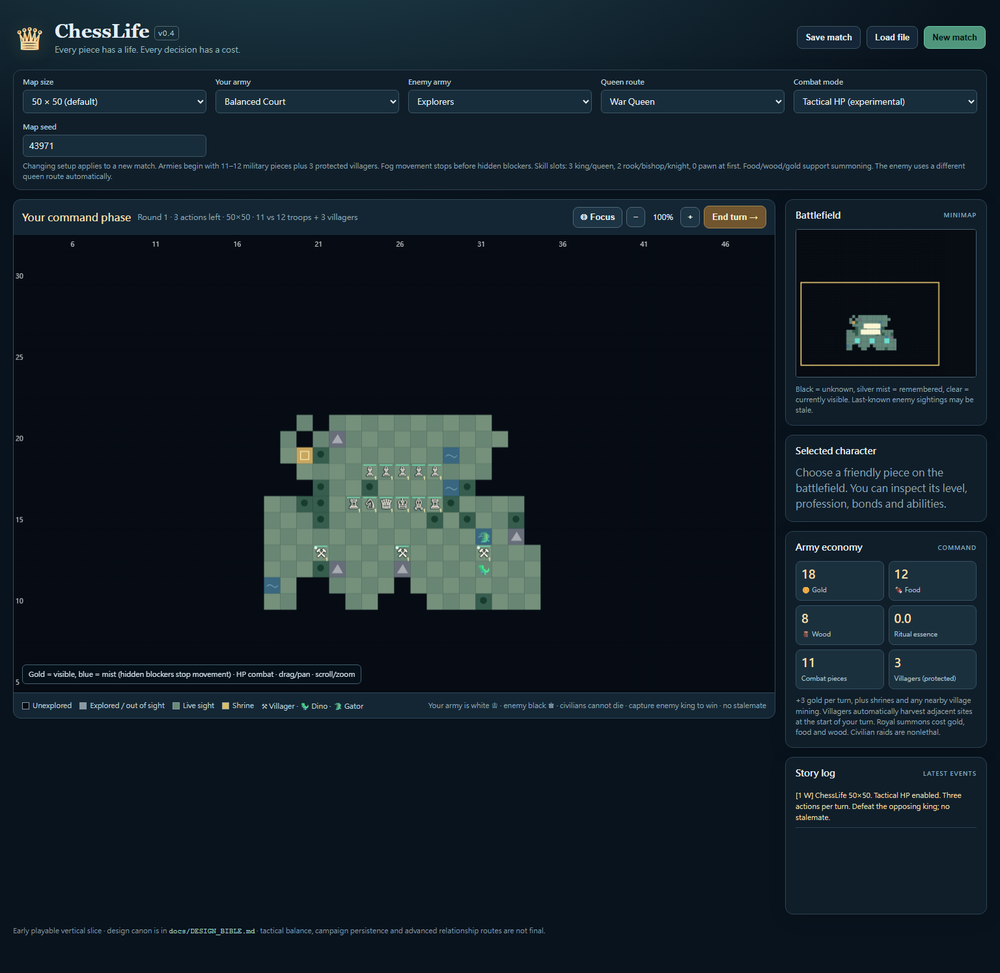
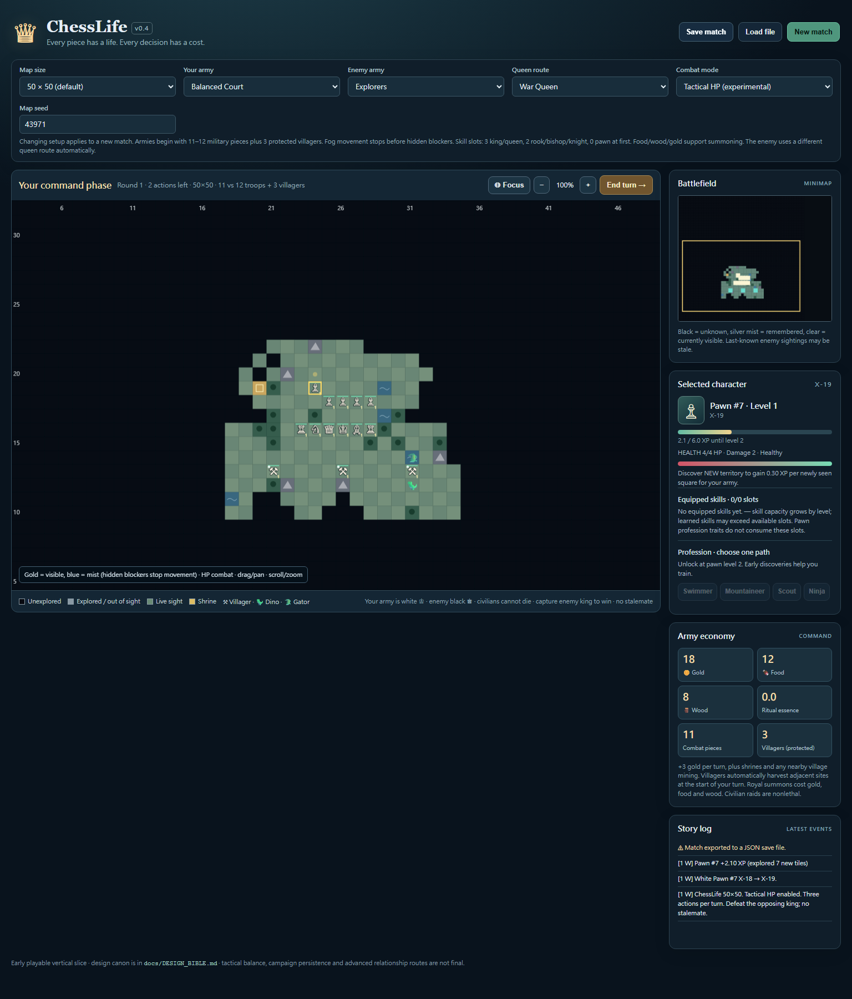
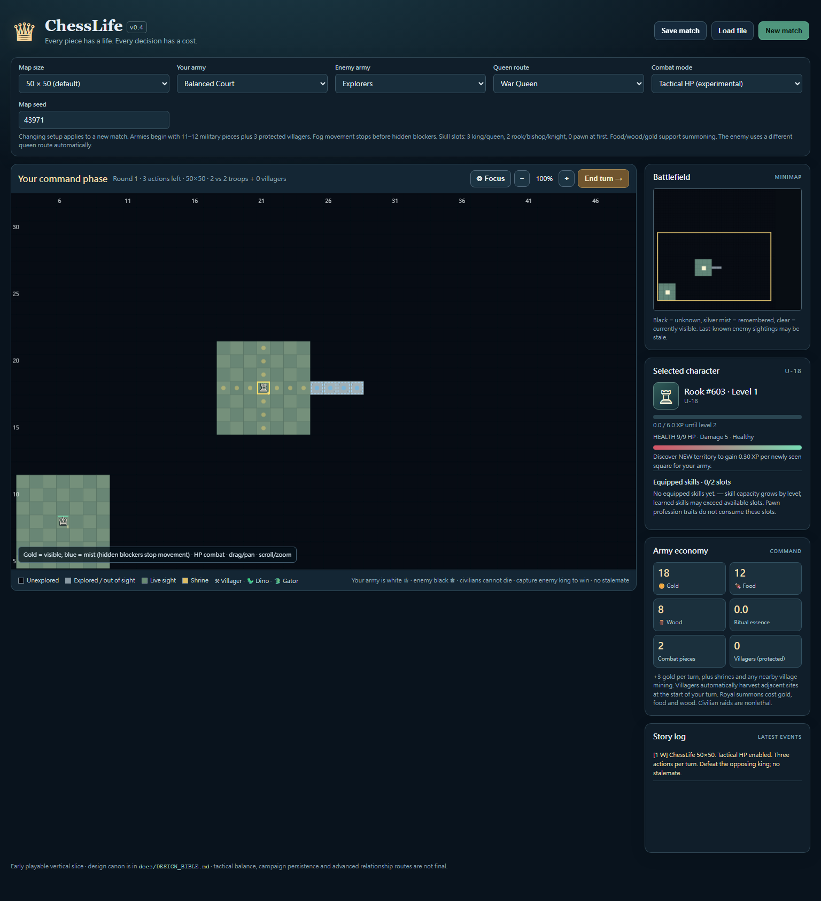

# v0.4 P0 verification receipt

Tested source: `8070772c89df6b0ea9550e2c438822d0aa9ff0da`, branch `handoff/v04-baseline-v05-design`, import PR #3. This evidence-only change preserves all imported runtime, build, and existing test files. No gameplay change or merge is proposed here.

## Imported source

- `prototype/engine.js`: Git blob `0b83ad196103c80f92ef07fd73fe343793803606`.
- `tests/engine.test.cjs`: Git blob `2b9d5c17f3030e307f8c69a4ef431be98c31d276`.
- Both committed and Git-normalized working-tree blob IDs match.
- **15/15** original SHA-256 manifest entries match committed bytes. Original `README.md` and `docs/*` map to `docs/v0.4/*`; runtime/tests/build paths are unchanged. [Exact hashes](manifest-verification.json).
- Windows checkout line-ending conversion is not a change to imported Git blobs. The original archive itself was not supplied locally; verification is against its committed manifest and coordinator's exact blob pins.

## Executed checks

Environment: Windows, Node **v24.20.0**; build Python **3.14.8**; isolated browser Python **3.13.16**, Playwright **1.64.1**, managed Chromium **156.0.8078.4**.

| Check | Result |
| --- | --- |
| `node tests/engine.test.cjs` | Exit 0; **35/35** checks. [Full stdout](engine.log). |
| `python tools/build_standalone.py` | Exit 0; `ChessLife_v0.4_Play.html`, **81,007 bytes**, in repository parent. |
| Original `python tests/browser_check.py` and `python tests/interaction_check.py` | Both initially exit 1: `ModuleNotFoundError: No module named 'playwright'`. |
| Original browser smoke after isolated Playwright install | Exit 1: `BrowserType.launch: Failed to launch chromium because executable doesn't exist at \\usr\\bin\\chromium`. |
| Both imported browser scripts using external environment adapter | Exit 0; every original assertion preserved. [Exact stdout](browser-existing.log). |

Built artifact SHA-256: `410d6f105fb255d598d50e3739d879aaefe89f5fe7bf5f0e5dec0a3187fa2fa2`. Build hash/size reflects Windows text output; the source Git blobs are the cross-platform identity pins.

The browser adapter removes only the hard-coded `/usr/bin/chromium` launch override so Playwright uses its installed browser, and redirects screenshot/save artifact paths outside the repository. It does not alter assertions, timeouts, game HTML or runtime code. The checked-in baseline browser scripts remain unchanged and still need a portable launcher before they can run directly on Windows.

Imported smoke coverage: initial 50x50/default seed 43971, 3 villagers and resources; new 70x70 Choice/classic match; AI reaches round 2; JSON save/load; viewport 420x860. Interaction coverage: Choice Queen learned-skill swap and villager reassignment to gator hunting. Browser errors: **[]**.

[Mobile screenshot](mobile.png). Screenshots were visually inspected: the board, controls, pieces and panels render; the application is not blank or crashed. Mobile capture is a smoke check, not a full touch/accessibility audit.

## Actual default move and targeted fog checks

External `default_50_browser_check.py`: **exit 0**, actual generated file opened directly in Chromium, without fixture/state mutation. Default seed 43971, 50x50, HP on, Balanced/Explorers and War/Phantom: clicked pawn #7 from zero-based **(32,23) to (31,23)**. AP decreased **3 to 2**, pawn was marked acted, only its position changed, and army count/resources were unchanged. No browser errors. [Exact result](default-move-results.json).

External `supplementary_browser_check.py`: **exit 0, six checks**, uploaded a controlled 50x50 seed-9234 numeric-HP save fixture, then used real canvas clicks and save/load controls. Three-state fog was verified in exported state and distinct canvas pixels. An unexplored black target was rejected without spending AP. A rook ordered **(32,20) to (32,27)** stopped at **(32,23)** before a hidden pawn at **(32,24)**, spent **one AP**, was marked acted, and left the blocker alive with **4 HP**. Save, reload and save again produced exactly equal complete game state, including positions, AP, HP, fog, XP and interruption event. No page or console errors. [All six assertions and pixel evidence](fog-mist-results.json).

## Deterministic reproduction

Six paired Node runs used seed **9234**, sizes **30/50/70**, HP **true/false**, Balanced/Expedition armies and War/Phantom routes. White passed; black used the existing AI. Each pair compared actions and full game state after every command.

**359 commands per set** matched: five runs reached 60 commands; 30x30 classic ended on command 59 with black victory. This is a repeatability check, not a balance or fun measurement. `aiChoice` advances the saved RNG, so seed/config **and call order** must match. A blank/zero UI seed can use the clock; record the effective saved seed.

## Reproduce play

At the tested source SHA, run `node tests/engine.test.cjs`, then `python tools/build_standalone.py`. Open the generated `../ChessLife_v0.4_Play.html` in a browser. Keep 50x50, seed 43971 and the default armies/routes; click a white pawn and a highlighted forward square. Use **Save match** to export JSON and **Load file** to restore it. For a modular build, run `python -m http.server 8765 --directory prototype` and open `http://localhost:8765`.

## Known limits and review status

- No competitive information isolation: full hidden state remains client-side; observer/AI boundaries are incomplete.
- Level-99 identity trees are skeletal. Economy, numeric HP, queen strength and game length are not established as balanced or fun.
- Forced-pass scheduling needs more coverage; the existing no-stalemate behavior and king-capture rule were preserved.
- Browser evidence is Chromium-only, not Firefox/WebKit or a real mobile device. No CI run was claimed or added.
- Save import recomputes sight and lacks a general migration framework. The setup form can still show its prior seed after loading a different-seed fixture; actual fixture configuration is verified from exported state.
- P0 technical evidence awaits coordinator review. `baseline/v04-golden` is read-only. Discrete hits, Fission, economy-off and new permanent defaults are not implemented by this receipt.
